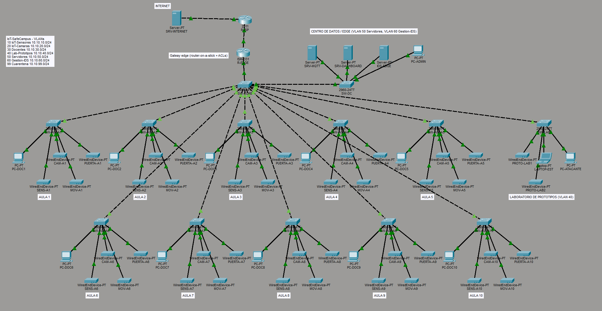

# IoT-SafeCampus

**Detección ligera de anomalías en el edge para redes IoT educativas.**

IoT-SafeCampus es un sistema de detección de intrusiones (IDS) que corre en un
gateway edge, analiza los registros NetFlow que exporta el router del campus y
aísla los dispositivos comprometidos en una VLAN de cuarentena. El proyecto
compara nueve detectores, ligeros y pesados, en precisión y consumo de recursos.

Proyecto del Equipo 9 · BUAP.

## Contenido del repositorio

| Carpeta | Contenido |
|---|---|
| [`reporte/`](reporte/) | Artículo del proyecto ([PDF](reporte/articulo_IoT-SafeCampus.pdf) y DOCX) |
| [`infra/`](infra/) | Parte 1: red del campus en Cisco Packet Tracer (`.pkt`), plan de la topología, configuración de seguridad de R-EDGE y scripts que generan el plan y el plano físico |
| [`ids/`](ids/) | Parte 2: IDS en Python (generador de tráfico, detectores, experimento, gateway edge), pruebas, dataset sintético y resultados |
| [`img/`](img/) | Topología lógica y plano físico |

## Parte 1 · Red en Packet Tracer



- Campus de **10 aulas** (cada una con switch, PC docente, sensor de temperatura,
  sensor de movimiento, cámara IP y cerradura inteligente), laboratorio, centro
  de datos y nodo IDS-EDGE: 74 dispositivos en total.
- **7 VLANs** en el router R-EDGE: sensores (10), cámaras (20), docentes (30),
  laboratorio (40), servidores (50), gestión e IDS (60) y cuarentena (99).
- **ACLs de mínimo privilegio**: sensores y cámaras solo alcanzan el broker y el
  dashboard; la cuarentena solo habla con gestión e IDS; desde Internet solo
  entra tráfico de retorno.
- **NetFlow** exportado desde R-EDGE hacia IDS-EDGE.

Archivos:

- `infra/IoT-SafeCampus.pkt`: red completa en operación normal.
- `infra/IoT-SafeCampus-cuarentena.pkt`: la misma red con un dispositivo movido a la VLAN 99.
- `infra/r-edge_seguridad.cfg`: ACLs y NetFlow de R-EDGE.
- `infra/iot_safecampus_plan.json`: inventario de dispositivos, IPs, VLANs y puertos (lo lee el IDS).
- `infra/build_plan.py`, `infra/plano_fisico.py`, `infra/fondo_fisico.py`: generan el plan y el plano físico.

## Parte 2 · IDS en Python

El gateway sigue este flujo: registros NetFlow → extractor de características
→ modelo ligero → alertas → reglas de aislamiento (VLAN 99) → tablero HTML.

Los detectores evaluados: reglas z-score por perfil, Isolation Forest,
autoencoder ligero, árbol de decisión, bosque ligero (10 árboles), híbrido
árbol + autoencoder, Random Forest (300 árboles) y MLP profunda.

Se evaluó en dos escenarios:

- **A · Campus sintético**: tráfico NetFlow etiquetado generado a partir del
  inventario de la topología, con 6 escenarios de ataque y una exfiltración que
  nunca aparece en entrenamiento.
- **B · Dataset real NF-ToN-IoT-v3** (Luay et al., 2025, UQ): división temporal
  en la que los ataques de prueba (password, xss, ransomware, backdoor, mitm) no
  aparecen en entrenamiento.

### Resultado principal (NF-ToN-IoT-v3, 5 semillas)

| Modelo | F1 | Throughput (flujos/s) | CPU por flujo (µs) | Tamaño del modelo |
|---|---|---|---|---|
| Bosque ligero (10 árboles) | **0.90** | 3.5 M | 1.16 | 2.6 MB |
| Random Forest (300 árboles) | 0.77 | 113 k | 12.5 | 127 MB |

El bosque de 10 árboles supera al Random Forest de 300 con 31 veces más
throughput y un modelo 49 veces más pequeño. Las tablas completas están en
`ids/results/summary.csv` (escenario A) e `ids/results/nf3/summary.csv` (escenario B).

### Cómo ejecutarlo

```bash
cd ids
python -m venv .venv
.venv/Scripts/python -m pip install -r requirements.txt   # Windows (Linux: .venv/bin/python)

.venv/Scripts/python -m pytest                            # pruebas
.venv/Scripts/python -m safecampus.generator              # dataset sintético -> data/flows.csv.gz
.venv/Scripts/python -m safecampus.experiment --seeds 5   # experimento -> results/
.venv/Scripts/python -m safecampus.edge train --model zscore
.venv/Scripts/python -m safecampus.edge run --day 3       # gateway -> results/edge/
```

Más detalle del protocolo y de cada módulo en [`ids/README.md`](ids/README.md).

### Dataset

- `ids/data/flows.csv.gz`: dataset sintético del campus (incluido).
- `ids/data/nf3_subset.json`: particiones temporales usadas de NF-ToN-IoT-v3.
- `ids/data/NetFlow_v3_Features.csv`: descripción de las características NetFlow v3.
- **NF-ToN-IoT-v3 no está incluido** (5 GB). Se descarga desde el navegador en
  <https://espace.library.uq.edu.au/view/UQ:44d7c5e>, se guarda en
  `ids/data/external/` y se procesa con:

```bash
.venv/Scripts/python -m safecampus.nf3 build            # -> data/nf3_subset.pkl
.venv/Scripts/python -m safecampus.nf3 run --seeds 5    # -> results/nf3/
```

## Equipo 9

Huerta Martínez Adolfo · Sánchez Hernández Ángel Desiderio ·
Hernández González Juan Manuel · Valdez Colin Erwin Yago
